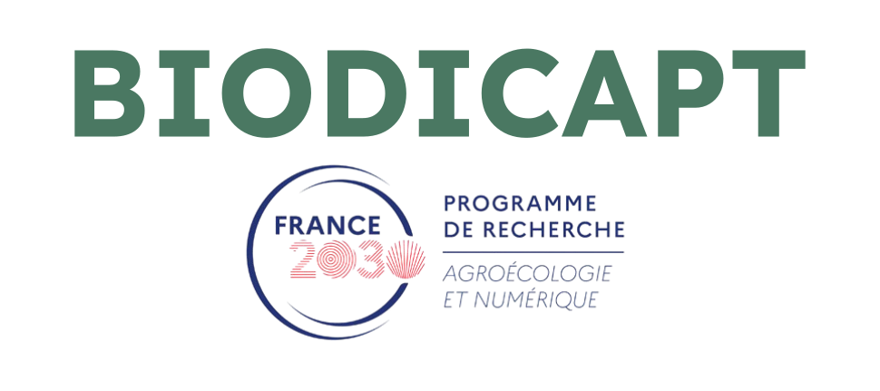

I know, I know, we are missing a custom logo... 

For now, that'll do. That's the best I could make with my Inkscape skills!

---

### About the project

The project just started this year. It is very ambitious, in a nutshell, it aims at being able to describe and monitor multiple components on a large scale:

- Biodiversity, including a large number of taxa.
- Agricultural practices.
- Agroecological infrastructures (AEI).
- The ecological functions underlying ES.

You can find the details on the website of our funders : [PEPR-agroeconum/BIODICAPT](https://eng-pepr-agroeconum.custom.hub.inrae.fr/funded-projects/socio-ecosystem/cfp-awarded-projects/biodicapt)

### Results

As the project just started, there are currently no results published. 

I am currently working on producing a priority map of the places to sample, based on the species we want to monitor (birds, mainly) and the availabity of volunteers farmers. This is a science field names "Optimal Experimental Design".

But! I already produced one report for this project. It is an inventory of most of the acoustic recorders that are available on the market, their features and how to pick one. It is a pretty nice document, however, it is only available in french. The important tables are readable with pretty basic knowledge of French, do not hesitate to read it! 

→ See https://doi.org/10.5281/zenodo.19609812