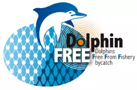

---

### The objective

The aim of the project was to limit dolphin mortality caused by pelagic trawler and gillnet fishing in the Bay of Biscay. Based on bio-acoustic and cognitive knowledge of the dolphin, it aimed to propose a prototype of an acoustic beacon emitting a signal that can be understood and interpreted by dolphins to alert them of the presence of a fishing net, and the associated risk of mortality.

For my details, see this dedicated webpage: https://umr-marbec.fr/en/the-projects/dolphinfree/

### The results

Well, I am not going to bore you by writing my whole thesis defense here but to summarize:
- We recorded hours of dolphin sounds that *I* had to analyse
- We found out that dolphins do react to the sound emitted by the prototype
- Usually, they react by emitting more echolocation clicks, meaning that they are more aware of their surroundings.

If you want the longer version (aka my manuscript), it's available here: [theses.fr/2024UMONG103](https://theses.fr/2024UMONG103)

### What's next for the project

Now that we have a working prototype, it must be tested at sea, while fishing. It was planned to be deployed in 2025 on hundreds of vessels, I have no update for you unfortunately.

However, there was action taken by the governement recently: fishing was suspended during the weeks where the mortality is the highest annually, with promising results! (see [this article](https://www.observatoire-pelagis.cnrs.fr/captures-de-dauphins-communs-effet-de-la-fermeture-de-la-peche-en-2025/) on the PELAGIS website).
