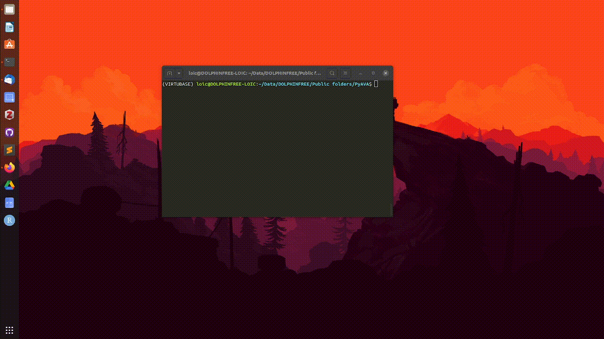

PyAVA is a graphical annotation tool written in Python whose purpose is to provide an easy way to draw contours on vocalisations from audio recordings. It uses Tkinter for its graphical interface and can be run on any OS. It does not require images (nor spectrograms) to function, only waveforms, which is its main advantage!

---

### Why a new tool?

In bioacoustics, you are sometimes faced with problems that are not even considered in other fields.

When labelling images, you usually just take your photographs and run them into [LabelMe](https://labelme.io/), [Labellmg](https://pypi.org/project/labelImg/) or [roboflow](https://roboflow.com/) to annotate them. These tools have many useful features to treat images, and have been used for years by scientists and others. 

The thing is...sounds are not images. You tipycally need to go through many steps before a sound resembles an image:
1. Filter out noise
2. Chose parameters (fft, hop length, window type, ...)
3. Convert to spectrogram
4. Save as image

But this means that you have need large storage for these images, and that you lose time-frequency information when saving cells into pixels. These tools are not made for acoustic data.

That's why I made PyAVA. It is designed specifically to handle acoustic data: it computes spectrograms locally, parameters can be customised and labels can be bounding boxes or contour annotations.

### How to use it?
If I did a good job, it's all explained on its gitlab page here: [gitlab.lis-lab.fr/dolphinfree-experiments/PyAVA](https://gitlab.lis-lab.fr/dolphinfree-experiments/PyAVA)!

However, I never tested it on external machines so... If there are bugs it's my bad, sorry!