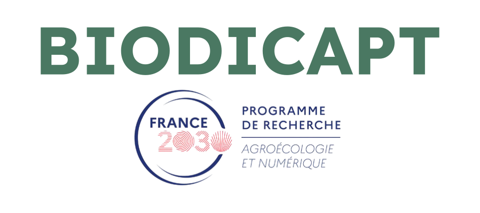

Je sais, je sais, ce logo est basique...

Il est temporaire ! C'est le mieux que je puisse faire en attendant d'avoir un logo définitif.

---

### A propos du projet

Le projet vient de débuter (cette année). Il est très ambitieux, on cherche à décrire et surveiller plusieurs éléments à large échelle:

- Biodiversité pour un grand nombre de taxons.
- Partiques agriculturales.
- Infratructures agro-écologiques.
- Les fonctions écologiques des ecosystèmes.

Pour plus de détails, reportez-vous au site de notre financeur : [PEPR-agroeconum/BIODICAPT](https://eng-pepr-agroeconum.custom.hub.inrae.fr/funded-projects/socio-ecosystem/cfp-awarded-projects/biodicapt)

### Résultats

Comme le projet vient à peine de débuter, il n'y a pas encore de résultats publiés.

Je travaille actuellement à établir une carte permettant de prioriser les parcelles agricoles à échantillonner sur le territoire métroplitain. Cette carte prendra en compte les agriculteurs volontaires, les espèces à échantillonner et la puissance statistiques de chaque relevé de données. Je m'appuie pour cela sur des méthodes de "planification expérimentales optimales".

Cependant ! J'ai déjà produit un rapport pour ce projet. Il s'agit d'un inventaire des capteurs acoustiques qui sont disponibles sur le marché, contenant un comparatif de leurs caractéristiques. Il y a également une section consacrée aux outils d'imagerie aérienne. N'hésitez pas à vous en servir !

→ Dispo ici : https://doi.org/10.5281/zenodo.19609812