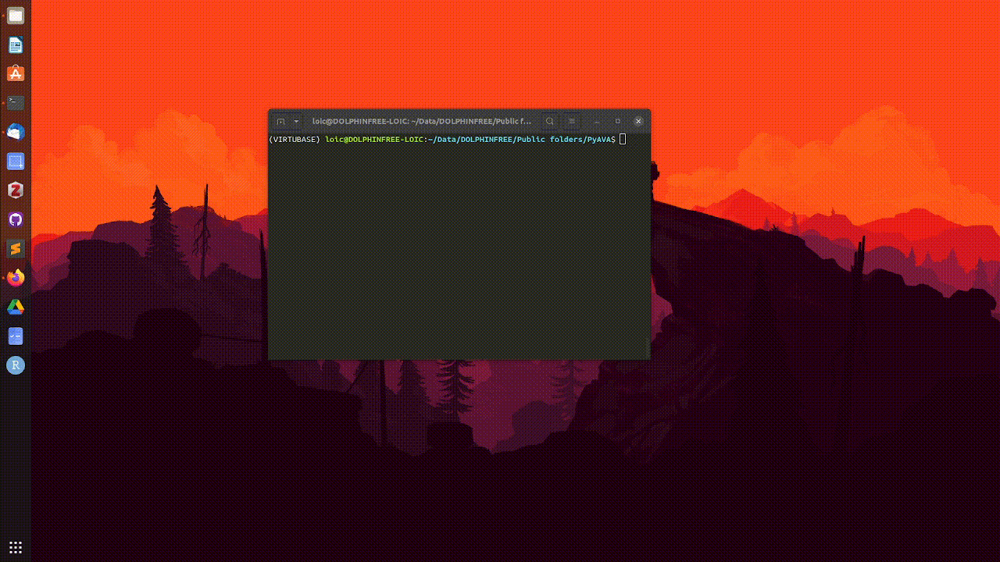

PyAVA est un outil d'annotation graphique écrit en Python, conçu pour permettre de tracer facilement des sifflements, issus d'enregistrements audio. Il utilise Tkinter pour son interface graphique et peut fonctionner sur n'importe quel système d'exploitation. Il ne nécessite ni images (ni spectrogrammes) pour fonctionner, mais uniquement des signaux acoustiques, ce qui est son avantage principal ! 

---

### Pourquoi un nouveau logiciel ?

En bio-acoustique, on a parfois des objectifs qui ne sont même pas envisagés dans d'autres domaines.

Quand on label des images par exemple, on a juste besoin de passer nos photos dans [LabelMe](https://labelme.io/), [Labellmg](https://pypi.org/project/labelImg/) ou [roboflow](https://roboflow.com/) pour les annoter. Ces outils sont blindés de fonctionnalités pour les images, et utilisés des années par la communauté scientifique et au-delà. 

Le truc... c'est que le son, ne sont pas des images. Avant qu'un son ressemble à une image, il faut passer par plusieurs étapes. Au minimum:
1. Filtrer le bruit ambiant
2. Choisir des paramètres (fft, taille de superposition, type de fenêtre, ...)
3. Conversion en spectrogramme
4. Sauvegarde en image

Mais faire cela signifie qu'on a besoin de beaucoup plus d'espace de stockage, et que l'on perd l'information de la position en temps-fréquence lorsque l'on sauvegarde une image en pixels. Bref, ces outils ne sont pas faits pour des données acoustiques.

C'est pour cela que j'ai codé PyAVA. Ce logiciel est fait pour traiter des données acoustiques : les spectrogrammes sont calculés localement, paramétrables en direct, et on peut à la fois annoter les contours des sifflements et ajouter des bounding boxes.

### Comment l'utiliser ?
Si j'ai fait du bon boulot, tout est expliqué sur la page Gitlab ici : [gitlab.lis-lab.fr/dolphinfree-experiments/PyAVA](https://gitlab.lis-lab.fr/dolphinfree-experiments/PyAVA)!

Cependant... Je n'ai jamais vraiment testé ce programme sur des machines externes. Donc s'il y a des bugs c'est ma faute, désolé !